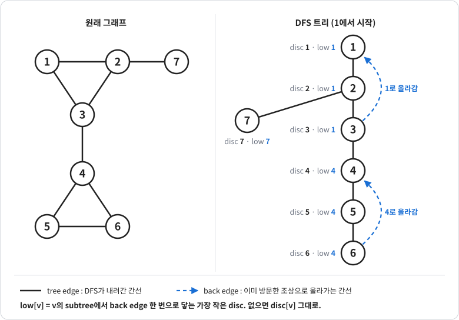
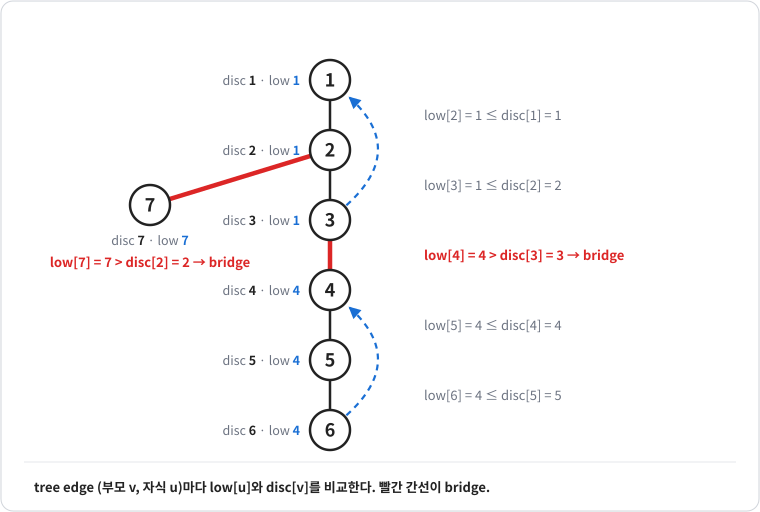
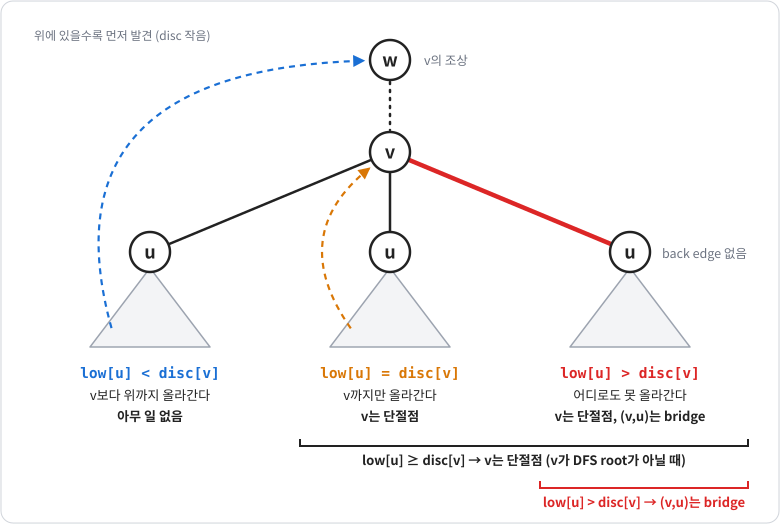
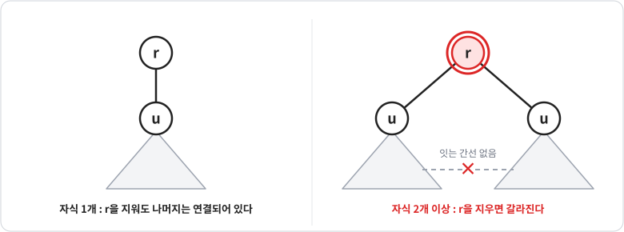
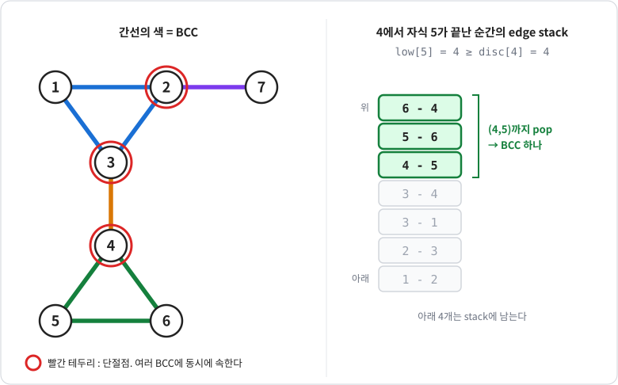
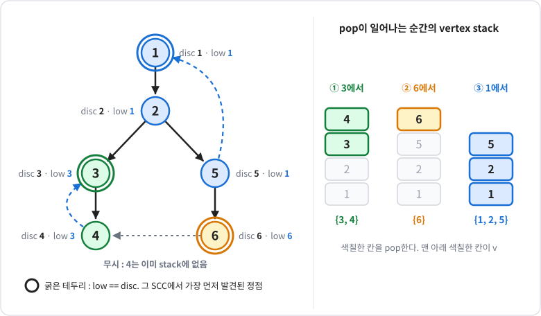

좋아. 지금까지 본 세 문제를 하나의 틀로 묶으면 이거야.

\[
\boxed{\text{DFS를 하면서 }disc\text{와 }low\text{를 구하고, low가 경계를 알려준다}}
\]

세 문제는:

1. 무방향 그래프의 **bridge**
2. 무방향 그래프의 **articulation point / vertex-biconnected component**
3. 방향 그래프의 **SCC**

이 셋이다.

공통 출발점부터 보자.

`disc[v]`는

> DFS에서 `v`를 몇 번째로 발견했는가

이고,

`low[v]`는 대충

> `v` 아래쪽에서 DFS tree를 따라 내려갔다가, 다른 간선을 이용해서 얼마나 옛날 정점까지 돌아갈 수 있는가

를 나타낸다.

즉 모든 문제에서 질문은 비슷하다.

```text
v 아래쪽 세계가
v보다 위쪽 세계와
얼마나 연결되어 있나?
```

예시 그래프 하나로 보면 이렇다.



- `low[5] = 4` : 5의 subtree `{5, 6}`에서 back edge `6 → 4`를 타면 4까지 올라간다.
- `low[2] = 1` : 2의 subtree 안에 있는 back edge `3 → 1`을 타면 1까지 올라간다.
- `low[7] = 7` : 7에는 올라가는 간선이 없다. 자기 `disc`가 그대로 남는다.

---

## 1. Bridge 찾기

무방향 그래프.

부모 `v`, DFS 자식 `u`가 있다고 하자.

```text
    ... 조상
       |
       v
       |
       u
      / \
   subtree
```

`u` 쪽에서 위로 돌아가는 우회로가 있다면

\[
low[u] \le disc[v]
\]

이다.

그런데

\[
\boxed{low[u] > disc[v]}
\]

라면?

`u` subtree에서는 `v`조차도 다른 길로 못 돌아온다는 뜻이다.

즉 `v-u`가 유일한 연결이다.

따라서

\[
\boxed{low[u] > disc[v] \Rightarrow (v,u)\text{는 bridge}}
\]

이게 첫 번째 문제.

그리고 bridge를 다 제거하면 남은 connected components가 2-edge-connected components다.

위 예시에서 tree edge마다 비교하면 이렇다.



- `3 - 4` : 4의 subtree `{4, 5, 6}` 안의 back edge는 4까지만 올라간다. 3으로 돌아갈 다른 길이 없다.
- `4 - 5` : back edge `6 → 4`가 이 간선을 건너뛴다. 그래서 bridge가 아니다.

---

## 2. Articulation point / Vertex-BCC

이것도 무방향 그래프다.

이번에는 간선 하나가 아니라 **정점 `v`를 없앴을 때 갈라지는가**를 본다.

부모 `v`, 자식 `u`에 대해

\[
\boxed{low[u] \ge disc[v]}
\]

라면 `u` subtree는 `v`보다 위의 조상으로 갈 수 없다.

중요한 건 `=`도 포함된다는 거야.

예를 들어

```text
u subtree → ... → v
```

까지는 돌아올 수 있어도 `v`보다 위에는 못 간다면,

`v`를 삭제하는 순간 그 길도 사라진다.

자식 subtree가 어디까지 올라가는지에 따라 세 경우로 나뉜다.



가운데 경우가 `=`가 필요한 이유다. `(v,u)`는 bridge가 아니지만 `v`는 단절점이다.

그래서 일반 정점에 대해

\[
\boxed{low[u] \ge disc[v]}
\]

인 자식이 하나라도 있으면 `v`는 articulation point다.

단 DFS root는 별도:

\[
\boxed{\text{root의 DFS child 수} \ge 2}
\]

이면 articulation point.



- root 위에는 아무도 없다. 그래서 `low[u] >= disc[root]`가 항상 참이고, 판정에 쓸 수 없다.
- 무방향 DFS에서는 두 자식 subtree를 직접 잇는 간선이 없다. 있었다면 DFS가 그 간선을 타고 내려가서 한 subtree가 되었을 것이다.

그리고 **vertex-biconnected component 자체를 구하려면 edge stack**을 쓴다.

DFS하면서 간선을 stack에 넣고,

\[
low[u] \ge disc[v]
\]

가 되는 순간 `(v,u)`까지 pop하면 하나의 BCC다.



위 예시에서 pop이 일어나는 순서는 이렇다.

| 순간 | 판정 | pop한 간선 |
|---|---|---|
| 4에서 자식 5가 끝남 | `low[5] = 4 >= disc[4] = 4` | `6-4`, `5-6`, `4-5` |
| 3에서 자식 4가 끝남 | `low[4] = 4 >= disc[3] = 3` | `3-4` |
| 2에서 자식 7이 끝남 | `low[7] = 7 >= disc[2] = 2` | `2-7` |
| 1에서 자식 2가 끝남 | `low[2] = 1 >= disc[1] = 1` | `3-1`, `2-3`, `1-2` |

마지막 줄은 root라서 항상 pop한다. 1은 자식이 하나뿐이라 단절점은 아니다.

즉 두 번째 문제는

```text
low[child] >= disc[parent]
```

가 경계다.

---

## 3. SCC

이번에는 방향 그래프다.

여기서는 의미가 조금 바뀐다.

`low[v]`는

> `v`의 DFS subtree에서, 아직 SCC가 확정되지 않아 stack에 살아 있는 정점 중 얼마나 옛날 정점까지 도달할 수 있는가

다.

그래서 정점 stack을 쓴다.

```text
stack = 방문했지만 아직 SCC가 확정되지 않은 정점들
```

그리고

\[
\boxed{low[v] = disc[v]}
\]

이면 `v`가 현재 SCC의 root다.

왜냐하면 `v` 아래의 살아 있는 정점들이 `v`보다 더 이전의 미확정 정점으로는 못 올라가기 때문이다.

그래서 stack에서 `v`가 나올 때까지 pop:

```text
x
y
z
v
```

→ `{v,z,y,x}` 하나의 SCC.

방향 그래프 예시로 보면 이렇다.



- 정점 번호는 발견한 순서다. 그래서 번호와 `disc`가 같다.
- `low == disc`인 정점은 1, 3, 6이다. 각자 자기 SCC에서 가장 먼저 발견된 정점이다.
- 간선 `6 → 4`는 무시한다. 4의 SCC `{3, 4}`는 이미 확정되어 stack에 없고, 그쪽으로 가면 돌아올 수 없다.
- 이 간선을 무시하지 않으면 `low[6]`이 4가 되어 6이 혼자 SCC라는 것을 놓친다.

즉 세 번째 문제는

\[
\boxed{low[v]=disc[v]}
\]

가 component 경계다.

---

세 개를 한 표로 보면 아주 깔끔하다.

| 문제 | 그래프 | low가 묻는 것 | 판정 |
|---|---|---|---|
| Bridge | 무방향 | 자식 subtree가 얼마나 위로 우회 가능한가 | `low[u] > disc[v]` |
| Articulation / BCC | 무방향 | 자식 subtree가 `v` 없이 위로 갈 수 있는가 | `low[u] >= disc[v]` |
| SCC | 방향 | 현재 미확정 정점 중 어디까지 되돌아갈 수 있는가 | `low[v] == disc[v]` |

그리고 stack도 정리하면:

```text
Bridge
    stack 필요 없음

Vertex-BCC
    edge stack

SCC
    vertex stack
```

가 된다.

---

가장 중요한 공통 철학은 이것이다.

DFS tree에서 항상

```text
        과거 / 위쪽
             |
             v
            / \
           u  ...
          / \
      미래 / 아래쪽
```

이런 구조를 만든다.

그다음 `low`가 말해준다.

> "이 아래쪽 세계가 위쪽 세계와 별도의 길로 연결되어 있나?"

그리고 그 답에 따라:

```text
완전히 연결 안 됨
→ bridge

v까지만 연결됨
→ v가 articulation 경계

방향 그래프에서 더 옛날 미확정 정점으로 못 감
→ SCC 경계
```

가 되는 거야.

그래서 세 알고리즘을 사실 따로 외울 필요가 별로 없다.

핵심 하나만 기억하면 된다:

\[
\boxed{\text{disc는 내가 언제 태어났는지, low는 내 subtree가 얼마나 과거까지 닿는지}}
\]

그리고 문제마다 **“얼마나 과거까지 닿아야 같은 덩어리냐”**의 기준만 달라진다.