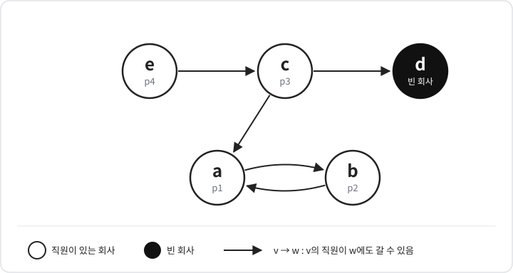
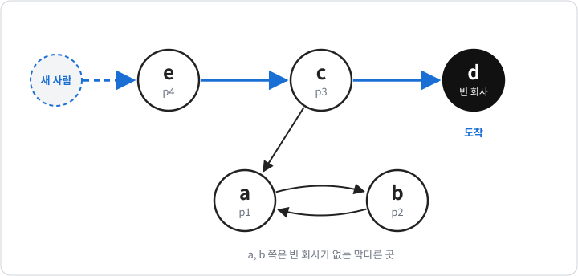

# 회사 그래프로 보는 이분 매칭

지금 배치를 **회사 사이의 방향 그래프**로 바꿔 놓고, 새 사람이 빈 회사까지 갈 수 있는지를 본다.

## 그리는 규칙

| 그림 | 뜻 |
|---|---|
| 흰 노드 | 직원이 있는 회사 |
| 검은 노드 | 빈 회사 |
| 화살표 `v → w` | `v`의 직원이 `w`에도 갈 수 있음 |
| 점선 화살표 | 새 사람이 갈 수 있는 회사 (시작점) |

## 예시

회사 5개, 직원 4명.

| 회사 | 직원 | 직원이 갈 수 있는 다른 회사 |
|---|---|---|
| a | p1 | b |
| b | p2 | a |
| c | p3 | a, d |
| d | 없음 | |
| e | p4 | c |



- 간선은 "지금 그 회사에 다니는 직원"이 정한다. 배치가 바뀌면 그래프도 바뀐다.
- 빈 회사 d에서는 나가는 간선이 없다. 직원이 없기 때문이다.
- 묻는 것은 하나다. **새 사람의 시작점에서 검은 노드까지 가는 경로가 있는가.**

## Case A : 검은 노드에 도달한다

새 사람이 e에 갈 수 있는 경우.



탐색 순서 (c의 직원 p3는 a를 먼저 본다)

```
e -> c -> a -> b -> a (이미 봄) -> 되돌아옴 -> d (빈 회사)
```

- a와 b는 서로만 가리키는 막다른 곳이다. 한 번 봤으니 다시 보지 않는다.
- 찾은 경로 `e → c → d`를 따라 한 칸씩 이사한다.

| 회사 | 전 | 후 |
|---|---|---|
| e | p4 | 새 사람 |
| c | p3 | p4 |
| d | 없음 | p3 |
| a | p1 | p1 |
| b | p2 | p2 |

기존 직원은 회사만 바뀌고 전원 취업 상태로 남는다. 취업자는 4명에서 5명이 된다.

## Case B : 검은 노드에 도달하지 못한다

새 사람이 a, b에만 갈 수 있는 경우.


탐색 순서

```
a -> b -> a (이미 봄) -> 실패
b (이미 봄)           -> 실패
```

- 도달할 수 있는 회사는 `R = {a, b}`이다. 빈 회사가 없고, 밖으로 나가는 간선도 없다. 닫힌 구역이다.
- `c → a`처럼 들어오는 간선은 상관없다. 나가는 간선만 본다.
- `R`의 회사에만 갈 수 있는 사람은 새 사람, p1, p2로 3명이다. 회사는 2개다.
- 어떻게 배치해도 이 셋 중 한 명은 실업자다. 취업자는 최대 4명이고, 지금 배치가 이미 4명이다.

이 예시에서는 실업자가 새 사람뿐이다. 예전에 실패한 실업자가 더 있으면 그 사람들의 시작점까지 포함해서 `R`을 잡는다. 자세한 증명은 [main2.cpp](../main2.cpp) 아래쪽 주석에 있다.

## 코드와의 대응

[main2.cpp](../main2.cpp) 기준.

| 그림 | 코드 |
|---|---|
| 노드에 들어감 | `dfs(v)` |
| 검은 노드 | `match[v] == -1` |
| 이미 본 노드 | `visited[v]` |
| 화살표 `v → w` | `for(auto w: adj[match[v]])` |
| 점선 화살표 | `main`의 `for(auto v: adj[u])` |
| 한 칸씩 이사 | `match[w] = u; match[v] = -1;` |
