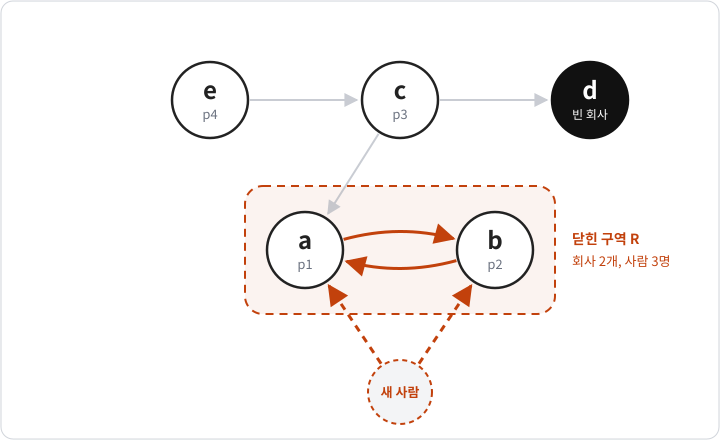
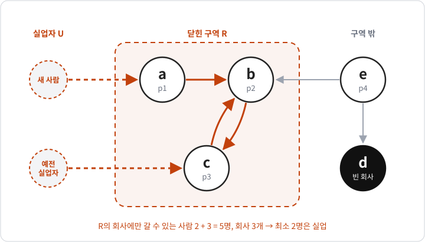

# 회사 그래프로 보는 이분 매칭

지금 배치를 **회사 사이의 방향 그래프**로 바꿔 놓고, 새 사람이 빈 회사까지 갈 수 있는지를 본다.

## 그리는 규칙

| 그림 | 뜻 |
|---|---|
| 흰 노드 | 직원이 있는 회사 |
| 검은 노드 | 빈 회사 |
| 화살표 `v → w` | `v`의 직원이 `w`에도 갈 수 있음 |
| 점선 화살표 | 새 사람이 갈 수 있는 회사 (시작점) |

## 예시

회사 5개, 직원 4명.

| 회사 | 직원 | 직원이 갈 수 있는 다른 회사 |
|---|---|---|
| a | p1 | b |
| b | p2 | a |
| c | p3 | a, d |
| d | 없음 | |
| e | p4 | c |


- 간선은 "지금 그 회사에 다니는 직원"이 정한다. 배치가 바뀌면 그래프도 바뀐다.
- 빈 회사 d에서는 나가는 간선이 없다. 직원이 없기 때문이다.
- 묻는 것은 하나다. **새 사람의 시작점에서 검은 노드까지 가는 경로가 있는가.**

## Case A : 검은 노드에 도달한다

새 사람이 e에 갈 수 있는 경우.


탐색 순서 (c의 직원 p3는 a를 먼저 본다)

```
e -> c -> a -> b -> a (이미 봄) -> 되돌아옴 -> d (빈 회사)
```

- a와 b는 서로만 가리키는 막다른 곳이다. 한 번 봤으니 다시 보지 않는다.
- 찾은 경로 `e → c → d`를 따라 한 칸씩 이사한다.

| 회사 | 전 | 후 |
|---|---|---|
| e | p4 | 새 사람 |
| c | p3 | p4 |
| d | 없음 | p3 |
| a | p1 | p1 |
| b | p2 | p2 |

기존 직원은 회사만 바뀌고 전원 취업 상태로 남는다. 취업자는 4명에서 5명이 된다.

## Case B : 검은 노드에 도달하지 못한다

새 사람이 a, b에만 갈 수 있는 경우.



탐색 순서

```
a -> b -> a (이미 봄) -> 실패
b (이미 봄)           -> 실패
```

- 도달할 수 있는 회사는 `R = {a, b}`이다. 빈 회사가 없고, 밖으로 나가는 간선도 없다. 닫힌 구역이다.
- `c → a`처럼 들어오는 간선은 상관없다. 나가는 간선만 본다.
- `R`의 회사에만 갈 수 있는 사람은 새 사람, p1, p2로 3명이다. 회사는 2개다.
- 어떻게 배치해도 이 셋 중 한 명은 실업자다. 취업자는 최대 4명이고, 지금 배치가 이미 4명이다.

이 예시에서는 실업자가 새 사람뿐이라 세기가 쉽다. 예전에 실패한 실업자가 더 있는 일반적인 경우는 아래에서 증명한다.

## 일반적인 경우 : 도달하지 못하면 지금 배치가 최적이다

새 사람이 검은 노드에 도달하지 못했다고 하자. 이때 새 사람을 넣지 않은 지금 배치가 최적임을 보인다.



기호

- `U` : 지금 실업자 전체. 새 사람과 예전에 실패한 사람들이다.
- `R` : `U`의 시작점들에서 화살표를 따라 도달할 수 있는 회사 전부.

### 1. `R`에는 검은 노드가 없다

- **새 사람의 시작점에서:** 도달하지 못한다. 방금 탐색해서 확인했다.
- **예전 실업자의 시작점에서:** 역시 도달하지 못한다. 도달할 수 있다면 새 사람 없이도 한 명을 더 취업시킬 수 있다. 지금 배치가 새 사람이 오기 전까지의 최대라는 것에 모순이다.

둘째의 근거는 "예전에 실패했다"가 아니라 "지금 배치가 최대다"이다. 그 사람이 실패한 뒤로 배치가 바뀌었기 때문에, 예전 탐색 결과를 그대로 쓸 수는 없다.

### 2. `R`에서 밖으로 나가는 화살표가 없다

- 나가는 화살표가 있다면 그 끝의 회사에도 도달할 수 있으므로, 그 회사도 `R`에 속한다.
- 화살표 `v → w`는 "`v`의 직원이 `w`에도 갈 수 있다"는 뜻이었다. 따라서 `R`의 직원들은 `R` 밖의 회사에 갈 수 없다.
- `U`의 사람들도 `R` 밖의 회사에 갈 수 없다. 갈 수 있는 회사가 곧 시작점이고, 시작점은 전부 `R` 안이다.

`e → b`처럼 밖에서 들어오는 화살표는 있어도 된다.

### 3. 세어 본다

| | 수 |
|---|---|
| `R` 밖의 회사에 갈 수 없는 사람 | `\|U\| + \|R\|`명 (`U` 전원과 `R`의 직원들. 1번에 의해 `R`의 회사마다 직원이 한 명씩 있다) |
| 이 사람들이 쓸 수 있는 회사 | `\|R\|`개 |

어떤 배치에서든 이 집단에서 최소 `|U|`명은 실업자다.

갈 수 있는 회사가 하나도 없는 사람도 `U`에 들어 있다. 이 사람은 시작점이 없어서 `R`에 회사를 보태지 않는다. 그래도 "`R` 밖의 회사에 갈 수 없는 사람"에는 해당하므로 똑같이 센다. `U`의 모두가 그런 사람이면 `R`이 비어 있고, `|U|`명에 회사 0개다.

### 결론

취업자는 최대 (전체 사람 수) − `|U|`명이다. 지금 배치의 실업자가 정확히 `|U|`명이므로, 지금 배치가 최적이다.

그림에서는 `|U| = 2`, `|R| = 3`이다. 5명이 회사 3개만 쓸 수 있으니 최소 2명은 실업자이고, 전체 6명 중 최대 4명이 취업한다.

모든 배치를 하나씩 탐색한 것이 아니다. 세는 논리가 모든 배치에 한꺼번에 적용된다.

### 전체 알고리즘이 맞는 이유

사람을 한 명씩 추가할 때마다 "지금 배치가 지금까지 온 사람들의 최대"라는 성질이 유지된다.

- **처음:** 사람이 없고 배치도 비어 있다. 최대다.
- **Case A:** 취업자가 한 명 늘었다. 사람 한 명을 추가해서 최대가 늘 수 있는 양은 1까지이므로, 늘어난 배치가 최대다.
- **Case B:** 배치를 그대로 둔다. 위 증명에 의해 그대로가 최대다.

## 코드와의 대응

[01_match.cpp](01_match.cpp) 기준. `dfs(u)`는 사람을 받지만, `dfs(match[v])`는 "회사 `v`에서 나가는 화살표를 따라간다"로 읽는다.

| 그림 | 코드 |
|---|---|
| 노드 `v`에 들어감 | `visited[v] = true;` |
| 검은 노드 | `match[v] == -1` |
| 이미 본 노드 | `if (visited[v]) continue;` |
| 화살표 `v → w` | `dfs(match[v])`가 도는 `for` (그 안의 `v`가 그림의 `w`) |
| 점선 화살표 | `main`에서 부른 `dfs(u)`가 도는 `for` |
| 한 칸씩 이사 | `match[v] = u;` |
