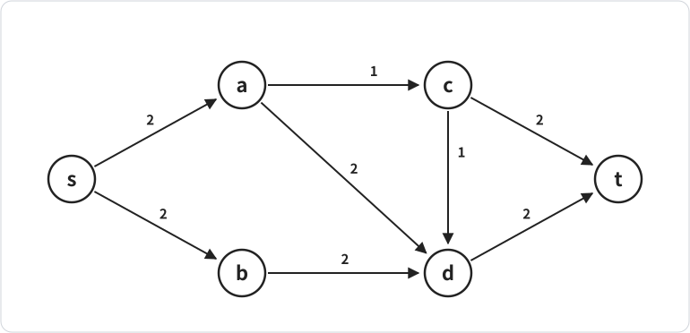
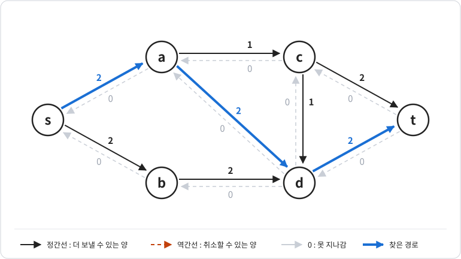
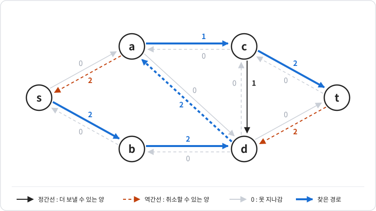
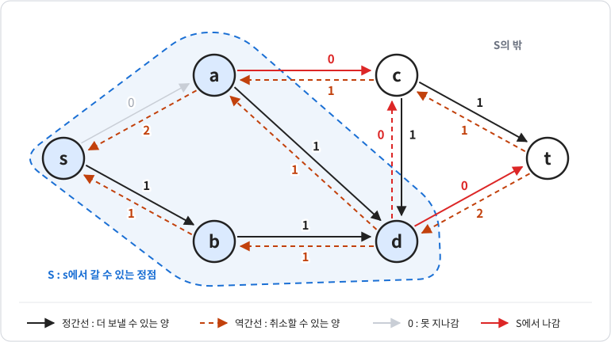
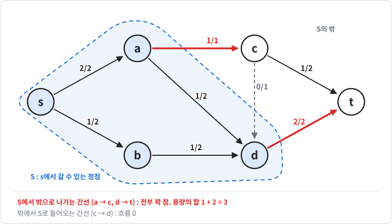

# 정간선과 역간선으로 보는 최대 유량

예시 그래프 하나를 [02_flow.cpp](02_flow.cpp)로 끝까지 돌리고, 끝났을 때의 모양을 본다.

## 예시 그래프



- s에서 t로 최대한 많이 보낸다. 숫자는 간선의 용량이다.
- 코드에 넣는 입력은 아래와 같다. 정점 번호는 s = 1, a = 2, b = 3, c = 4, d = 5, t = 6.

```
6 8
1 6
1 2 2
1 3 2
2 5 2
2 4 1
3 5 2
4 5 1
4 6 2
5 6 2
```

## 간선 하나 = 정간선 + 역간선

```
fwd : u --(C - f)--> v
bwd : v --(0 + f)--> u
```

| | 방향 | 숫자의 뜻 | 처음 |
|---|---|---|---|
| 정간선 | `u → v` | 더 보낼 수 있는 양 | `C` |
| 역간선 | `v → u` | 취소할 수 있는 양. 지금 보내고 있는 양과 같다 | `0` |

- `f`만큼 보내면 정간선은 `f` 줄고 역간선은 `f` 는다. 두 숫자의 합은 항상 `C`다.
- 숫자가 0인 화살표는 지나갈 수 없다.
- BFS는 정간선과 역간선을 구분하지 않는다. 숫자가 0보다 큰 화살표를 따라갈 뿐이다.

## 1회차 : s → a → d → t



- 처음 상태다. 역간선은 전부 0이다.
- BFS가 `s → a → d → t`를 찾는다.
- 병목은 `min(2, 2, 2) = 2`. 2를 보낸다.
- 경로 위의 정간선 셋은 2에서 0이 되고, 그 역간선 셋은 0에서 2가 된다.

## 2회차 : s → b → d → a → c → t



- `d → t`가 0이라서 d에서 t로 바로 갈 수 없다.
- 대신 역간선 `d → a`를 탄다. "a가 d로 보내던 것 중 일부를 취소한다"는 뜻이다.
- 병목은 `min(2, 2, 2, 1, 2) = 1`. 1을 보낸다.

실제 흐름으로 풀어 쓰면 이렇다.

| 간선 | 2회차 전 | 2회차 후 | 일어난 일 |
|---|---|---|---|
| `s → b`, `b → d` | 0 | 1 | b 쪽에서 d로 1이 새로 들어온다 |
| `a → d` | 2 | 1 | a가 d로 보내던 것 1을 취소한다 |
| `a → c`, `c → t` | 0 | 1 | a에 남은 1을 c 쪽으로 돌린다 |
| `d → t` | 2 | 2 | 그대로다. 그중 1을 이제 b 쪽에서 온 흐름이 채운다 |

새 길 하나를 따로 뚫은 것이 아니다. 기존 흐름을 고쳐서 1을 더 보낸 것이다.

## 3회차 : 경로 없음



- s에서 숫자가 0보다 큰 화살표를 따라 갈 수 있는 정점은 `S = {s, a, b, d}`이다. a에는 `s → b → d → a`로 간다.
- t가 `S`에 없다. 경로가 없으므로 끝난다. 최대 유량은 `2 + 1 = 3`.
- `S`에서 밖으로 나가는 화살표는 셋이고, 전부 0이다. 0이 아닌 것이 있었다면 그 끝의 정점도 `S`에 들어갔을 것이다.

## 최적해의 모양

역간선의 숫자가 그 간선에 실제로 흐르는 양이다. 흐름 / 용량으로 다시 그리면 이렇다.



`S`에서 나가는 화살표 셋이 0이라는 것을 원래 간선의 말로 옮긴다.

| 끝난 상태의 화살표 | 0이라는 것의 뜻 | 원래 간선으로는 |
|---|---|---|
| 정간선 `a → c`, `d → t` | 더 보낼 수 없다 | `S`에서 밖으로 나가는 간선은 전부 꽉 찼다 |
| 역간선 `d → c` | 취소할 것이 없다 | 밖에서 `S`로 들어오는 간선 `c → d`에는 흐름이 없다 |

- `S`의 경계를 넘는 흐름은 나가는 쪽으로 `1 + 2 = 3`, 들어오는 쪽으로 0이다.
- s에서 t로 가는 흐름은 전부 이 경계를 넘어야 한다. 넘는 양은 나가는 간선의 용량의 합 3을 넘을 수 없다.
- 지금 흐름이 정확히 3이다. 따라서 3이 최대다.

경로가 없다는 것은 꽉 찬 경계가 하나 있다는 것이고, 그 경계가 더 보낼 수 없다는 증거다.

| 간선 | 용량 | 흐름 | 정간선 | 역간선 |
|---|---|---|---|---|
| `s → a` | 2 | 2 | 0 | 2 |
| `s → b` | 2 | 1 | 1 | 1 |
| `a → d` | 2 | 1 | 1 | 1 |
| `a → c` | 1 | 1 | 0 | 1 |
| `b → d` | 2 | 1 | 1 | 1 |
| `c → d` | 1 | 0 | 1 | 0 |
| `c → t` | 2 | 1 | 1 | 1 |
| `d → t` | 2 | 2 | 0 | 2 |

## 코드와의 대응

| 그림 | 코드 |
|---|---|
| 정간선과 역간선 한 쌍을 만듦 | `append` |
| 숫자가 0인 화살표는 건너뜀 | `if(e.cap <= 0) continue;` |
| 병목 | `flow = min(flow, fwd.cap);` |
| 정간선은 줄이고 역간선은 늘림 | `fwd.cap -= flow; bwd.cap += flow;` |
| 3회차 | `bfs`가 `false`를 돌려줌 |
| `S` | 마지막 `bfs`가 끝났을 때 `parent[v].first != -1`인 정점 |
| 간선의 흐름 | 끝난 뒤 그 간선의 `bwd.cap` |

## 이분 매칭과의 관계

- 역간선을 타는 것은 이분 매칭에서 기존 직원을 다른 회사로 옮기는 것과 같다.
- [company_graph.md](company_graph.md)에서 닫힌 구역 `R`을 찾아 사람과 회사를 센 것이, 여기서 `S`의 경계를 세는 것과 같은 논리다.
